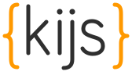

<p align="center">
  
</p>

<h1 align="center">Configure your UI.</h1>

<p align="center">
  Lightweight open source JavaScript framework for web applications
</p>

<p align="center">
  <a href="https://www.kijs.ch">kijs.ch</a> ·
  <a href="https://www.kijs.ch/kijs/">Home App</a> ·
  <a href="https://www.kijs.ch/kijs/home/#docu/Erste_Schritte">Getting started</a> ·
  <a href="https://www.kijs.ch/kijs/home/#api">API reference</a>
</p>

---

kijs is a JavaScript framework for web applications with a user interface like a
desktop program: windows, panels, forms, grids, trees, menus …

You describe your interface as **config objects** – kijs builds it.

```javascript
new kijs.gui.Window({
  caption: 'Hello kijs',
  iconMap: 'kijs.iconMap.Fa.face-grin-tongue',
  maximizable: false,
  resizable: false,
  innerStyle: { padding: '10px' },
  elements: [
    {
      xtype: 'kijs.gui.field.Text',
      label: 'Name'
    }
  ],
  footerElements: [
    '>',
    {
      xtype: 'kijs.gui.Button',
      iconMap: 'kijs.iconMap.Fa.check',
      caption: 'OK'
    }
  ]
}).show();
```

## Features

- **Configure, don't code** – build your interface from plain config objects instead of DOM code.
- **UI from the server** – a config is just data, so the server can deliver whole forms as JSON,
  e.g. generated from your database. Every element can reload its config with `load()`.
- **Desktop-style components** – windows, panels, forms with many field types, grids, trees,
  menus, drag and drop, dashboards …
- **Light and dark** – themes with light and dark color schemes, following the operating
  system or set by the application.
- **Multilingual** – translations, and numbers and dates formatted by language.
- **No dependencies** – plain JavaScript and CSS, no build step. Only the optional editor
  modules use [Ace](https://ace.c9.io) and [Quill](https://quilljs.com) (included in `lib/`).

## Getting started

1. Clone the repository into the folder `kijs` of your web server:

   ```bash
   git clone https://github.com/netas-ch/kijs.git
   ```

2. Open the **Home App** in your browser: `http://localhost/kijs/`

   The Home App is the best place to start. It contains:
   - **Getting started** – how to begin and in which order to read the guides
   - **Showcase** – every component with examples you can edit and run live
   - **Documentation** – guides and concepts
   - **API reference** – all classes with configs, functions and events

3. Create your first page. A minimal application is a plain HTML file with the CSS of a
   theme and kijs, the JavaScript files in the order given in [`files.json`](files.json),
   and your configuration:

   ```html
   <style>
       @layer kijs, kijs-theme, app;
   </style>
   <link rel="stylesheet" href="/kijs/css/kijs.theme.default.css">
   <link rel="stylesheet" href="/kijs/css/kijs.gui.css">

   <script src="/kijs/js/kijs.js"></script>
   <!-- … all further files of the modules core and gui, see files.json … -->

   <script>
       kijs.isReady(function() {
           const viewport = new kijs.gui.ViewPort({
               cls: 'kijs-flexfit',
               elements: [
                   {
                       xtype: 'kijs.gui.Panel',
                       caption: 'Hello kijs',
                       elements: [
                           { xtype: 'kijs.gui.field.Text', label: 'Name' },
                           { xtype: 'kijs.gui.Button', caption: 'OK' }
                       ]
                   }
               ]
           });
           viewport.render();
       });
   </script>
   ```

   The complete example with all `<script>` tags is in
   [Getting started](home/data/docu/Erste_Schritte.md). With PHP,
   `tools/getDebugHead.php` can create the `<script>` tags for you:

   ```php
   <?php
       echo file_get_contents('http://localhost/kijs/tools/getDebugHead.php?modules=core,gui&fileType=js');
   ?>
   ```

> **Note:** The documentation and the guides are currently written in German.

## Repository structure

| Folder            | Content                                                          |
|-------------------|------------------------------------------------------------------|
| `js/`             | Core: helper classes without GUI (`kijs.Array`, `kijs.Date`, `kijs.Rpc` …) |
| `js/gui/`         | GUI: the components (`kijs.gui.Button`, `kijs.gui.Window` …)     |
| `css/`            | CSS of kijs and the themes (`default`, `black`, `retro`)         |
| `fonts/`          | Fonts and icons (Roboto, Open Sans, Font Awesome)                |
| `lib/`            | Optional third-party libraries (Ace, Quill)                      |
| `home/`           | The Home App with showcase, tests, documentation and API reference |
| `tools/`          | Tools, e.g. `getDebugHead.php`                                   |
| `files.json`      | All files of each module in the order they must be loaded        |

## Changes

See the [History](home/data/docu/History.md) for the changes of each version.

## About

kijs is developed by [netas.ch](https://www.netas.ch).
Issues and pull requests are welcome.
